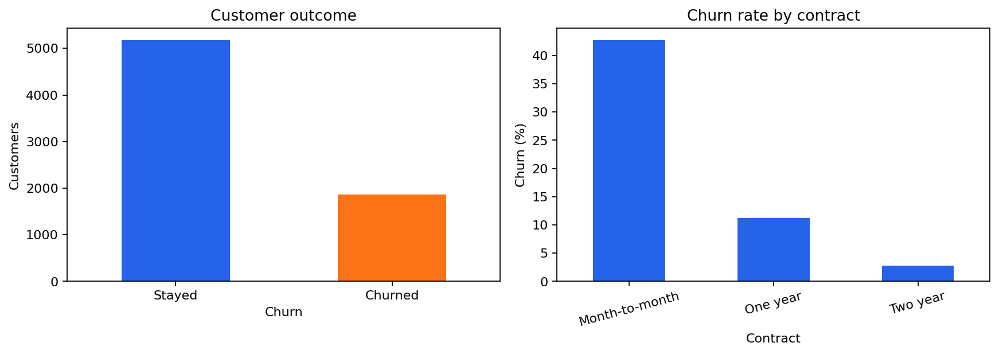
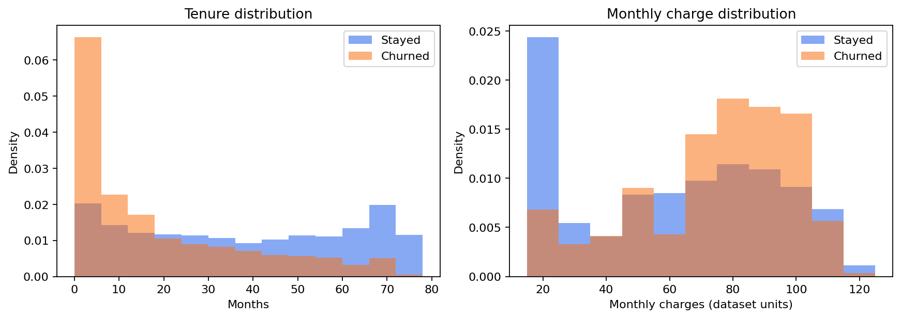
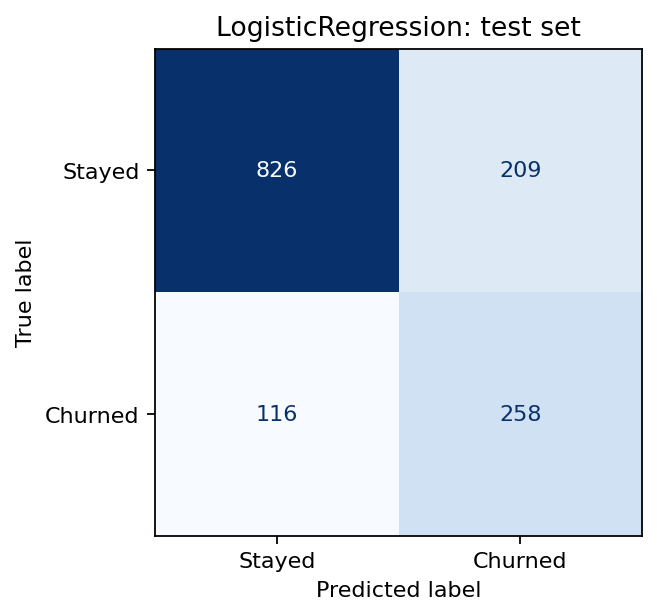
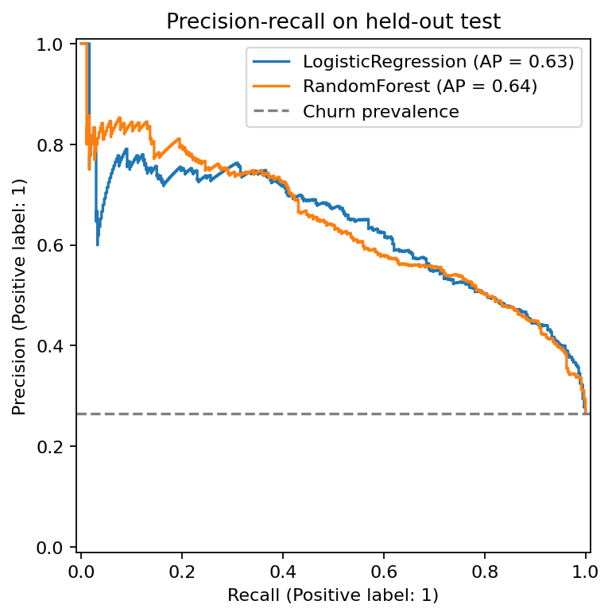

# Báo cáo Telco Customer Churn

## Dữ liệu và mục tiêu

Phân loại nhãn `Churn = Yes/No` của khách hàng viễn thông. Nhãn cho biết khách hàng đã rời dịch vụ trong tháng gần nhất; đây là bài thực hành phân loại trên dữ liệu mẫu, chưa chứng minh khả năng dự báo tương lai.

- Nguồn thực tế: Kaggle / BlastChar — https://www.kaggle.com/api/v1/datasets/download/blastchar/telco-customer-churn
- Trang Kaggle: https://www.kaggle.com/datasets/blastchar/telco-customer-churn
- SHA-256: `88be4b93fbe0cc83421af1c503794c97c342eca914c1576db7c276e61d61358a`
- 7,043 dòng, 21 cột gốc; dùng 19 đặc trưng sau khi bỏ `customerID` và `Churn`.
- Tỷ lệ churn: 26.54%; mã khách hàng trùng: 0.
- `TotalCharges`: 11 giá trị thiếu sau chuyển số; điền bằng trung vị học từ train.

## Phân tích mô tả

- Month-to-month: 3,875 khách hàng, tỷ lệ churn 42.7%.
- One year: 1,473 khách hàng, tỷ lệ churn 11.3%.
- Two year: 1,695 khách hàng, tỷ lệ churn 2.8%.

Các biểu đồ dùng toàn bộ dữ liệu cho mô tả. Chúng thể hiện liên hệ, không xác lập nguyên nhân khách hàng rời đi.

## Phương pháp

Chia stratified với seed 42: train 4,225, validation 1,409, test 1,409. Các tập không trùng khách hàng. Điền thiếu, chuẩn hóa số và one-hot encoding được fit chỉ trên train, giữ nguyên khi xử lý validation/test.

Baseline luôn dự đoán không churn. Logistic Regression (`max_iter=2000`) và Random Forest (300 cây, `min_samples_leaf=3`, `class_weight=balanced_subsample`) dùng cùng dữ liệu train. Tìm ngưỡng từ 0,10 đến 0,80, bước 0,01, bằng F1 validation; nếu hòa, ưu tiên gần 0,50. Chọn mô hình chỉ bằng F1 validation, không thay đổi lựa chọn theo test. Không refit bằng validation để giữ đúng mô hình và ngưỡng đã đánh giá.

### Kết quả validation

- Baseline_NoChurn: F1 = 0.000; ngưỡng = 0.50.
- LogisticRegression: F1 = 0.630; ngưỡng = 0.37.
- RandomForest: F1 = 0.623; ngưỡng = 0.46.

Mô hình được chọn: **LogisticRegression**.

### Kết quả test

| Mô hình | Ngưỡng | Accuracy | Precision | Recall | F1 | ROC-AUC | AP |
|---|---:|---:|---:|---:|---:|---:|---:|
| Baseline_NoChurn | 0.50 | 0.735 | 0.000 | 0.000 | 0.000 | 0.500 | 0.265 |
| LogisticRegression | 0.37 | 0.769 | 0.552 | 0.690 | 0.614 | 0.843 | 0.634 |
| RandomForest | 0.46 | 0.762 | 0.538 | 0.730 | 0.620 | 0.837 | 0.639 |

Accuracy có thể cao dù mô hình bỏ sót mọi ca churn, vì đa số khách hàng không churn. Precision là tỷ lệ churn thật trong nhóm bị cảnh báo; recall là tỷ lệ ca churn mô hình phát hiện được; F1 cân bằng hai giá trị này. AP tóm tắt đường precision–recall, baseline xấp xỉ tỷ lệ churn.

Mô hình được chọn: recall 69.0%, precision 55.2%, F1 0.614. Ma trận nhầm lẫn: TN=826, FP=209, FN=116, TP=258; còn bỏ sót 116 khách hàng churn và cảnh báo nhầm 209 khách hàng ở lại.

## Cách sử dụng và giới hạn

`models/churn_pipeline.joblib` chứa preprocessing và classifier; `models/model_metadata.json` chứa ngưỡng và schema. Chạy `python predict.py --input du_lieu_moi.csv --output du_doan.csv` với CSV có đủ 19 cột đặc trưng. Kết quả gồm xác suất và nhãn suy luận; xác suất chưa được hiệu chỉnh calibration.

Đây là dữ liệu mẫu cho học tập, không phải đánh giá trên khách hàng của doanh nghiệp đang hoạt động. Dữ liệu không có mốc thời gian để chia theo thời gian hoặc biết chính xác đặc trưng được ghi trước churn. Chỉ cân nhắc vận hành sau khi có dữ liệu thực tế, định nghĩa cửa sổ dự báo, kiểm tra theo thời gian và chi phí cảnh báo/bỏ sót. Chưa có thử nghiệm cho thấy việc giữ chân dựa trên mô hình làm giảm churn.
